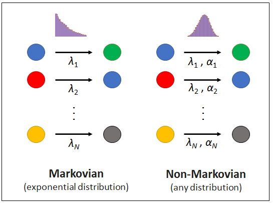
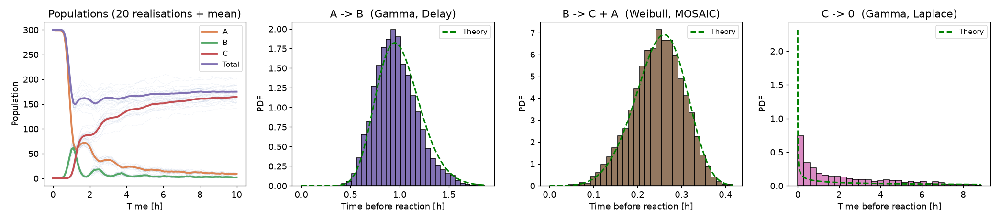

# NoMaSS: Non-Markovian Stochastic Simulation

[](https://github.com/AI-SysBio/NoMaSS/actions/workflows/ci.yml)
[](https://doi.org/10.1093/bib/bbag486)
[](LICENSE)



Discrete stochastic processes are widespread in nature and in human-made systems, with applications in physics, biochemistry, epidemiology, social dynamics and finance. In most of these systems the dynamics cannot be described with memoryless (Markovian) interactions, and simulating them requires dedicated numerical tools.

NoMaSS is a practical and scalable Gillespie-based framework to simulate non-Markovian reaction networks with arbitrary inter-event time distributions. It implements three exact methods that can be mixed freely in the same model, one per reaction channel:

* **MOSAIC** (rejection based, [1, 2]): propose events at an upper bound of the rate and accept them with the ratio of the true hazard to the bound.
* **Laplace Gillespie** [3]: give every reactant a Poisson rate drawn from the mixing density of its waiting-time distribution.
* **DelaySSA** [4]: draw the waiting time when a reactant enters a channel and schedule the event in a priority queue.

The methods, their accuracy and their speed are described in the accompanying paper [1].

&nbsp;

## Installation

NoMaSS needs Python 3.9+ with `numpy`, `scipy` and `matplotlib`. Clone the repository and install the dependencies:

```bash
git clone https://github.com/AI-SysBio/NoMaSS.git
cd NoMaSS
pip install -r requirements.txt
```

The engine is the `nomass/` folder. The examples add the repository root to `sys.path` so they run from anywhere; in your own scripts, run from the repository root, set `PYTHONPATH` to it, or copy the folder next to your script. A pip-installable package will follow.

Check that everything works with

```bash
python examples/toy_example.py
```

## Quick start

The example below ([examples/toy_example.py](examples/toy_example.py)) simulates a small network where each channel uses a different method:

```python
import nomass

class param:
    Tend = 10            # length of the simulation
    N_simulations = 20   # number of independent realisations
    timepoints = 100     # number of recorded time points (plots only)
    unit = 'h'           # time unit (plots only)

# Reaction channels: one waiting-time distribution and one method each
r1 = nomass.Reaction_channel(param, rate=1, shape_param=20, distribution='Gamma', method='Delay',
                             reactants=['A'], products=['B'], name='A -> B')
r2 = nomass.Reaction_channel(param, rate=4, shape_param=5, distribution='Weibull', method='MOSAIC',
                             reactants=['B'], products=['C', 'A'], name='B -> C + A')
r3 = nomass.Reaction_channel(param, rate=0.03, shape_param=0.5, distribution='Gamma', method='Laplace',
                             reactants=['C'], products=[], name='C -> 0')
r4 = nomass.Reaction_channel(param, rate=0.03,  # two reactants: Poisson process
                             reactants=['A', 'B'], products=[], name='A + B -> 0')

# Initial population (every species must be listed)
N_init = {'A': 300, 'B': 0, 'C': 0}

# Build and run the model
sim = nomass.Gillespie_simulation(N_init, param, [r1, r2, r3, r4])
populations = sim.run_simulations(verbose=True)   # array (N_simulations, timepoints, species + total)

# Plot the results
sim.plot_inter_event_time_distribution()
sim.plot_populations()
```

The simulation runs in a few seconds and produces the figures below (pass `verbose=False` to silence the progress output).

<p align="center">
  
</p>

The oscillations created by the nearly deterministic Gamma waiting times are clearly visible. The *theoretical* distributions do not match the *simulated* ones exactly, even with many realisations, and this is expected: species A and B are reactants of two channels at the same time, and the theoretical curve is the distribution the channel would have if it were the only process acting on its reactant. The accuracy of each method is demonstrated in [1] and [2].

## Choosing a method

| Method | Set with | Best for | Limitations |
| --- | --- | --- | --- |
| MOSAIC (rejection) | `method='MOSAIC'` | Large populations, state-dependent rates, any distribution with a bounded hazard | Hazard must be finite at t = 0 (Gamma and Weibull need a shape ≥ 1) |
| Laplace Gillespie | `method='Laplace'` | Heavy-tailed or decreasing hazards (Gamma/Weibull with shape < 1, Lomax), state-dependent rates | Only distributions whose survival function is a mixture of exponentials |
| DelaySSA | `method='Delay'` | Any distribution when rates are constant | Waiting times are frozen when drawn, so rates that change over time are not followed |

When `method` is omitted, NoMaSS uses MOSAIC if the hazard is bounded and Laplace Gillespie otherwise. Channels with zero or several reactants are always Poisson processes with propensity `rate × product of the reactant counts`, because the waiting time of an individual is not defined in that case.

## Supported distributions

| Distribution | MOSAIC | Laplace | DelaySSA |
| --- | :---: | :---: | :---: |
| Exponential | ✅ | ✅ | ✅ |
| Gamma | ✅ (α ≥ 1) | ✅ (α ≤ 1) | ✅ |
| Weibull | ✅ (α ≥ 1) | ✅ (α ≤ 1) | ✅ |
| Gaussian / Normal | ✅ | ❌ | ✅ |
| Lognormal | ✅ | ❌ | ✅ |
| Cauchy | ✅ | ❌ | ✅ |
| Power law, Pareto type I | ✅ | ❌ | ✅ |
| Power law, Lomax (Pareto type II) | ✅ | ✅ | ✅ |

Every distribution is parameterised by a nominal `rate` λ, the inverse of the mean waiting time (or of the median when the mean is undefined), and a dimensionless `shape_param` α (full details in Table S1 of [1]):

| Distribution | `rate` | `shape_param` |
| --- | --- | --- |
| Exponential | 1 / mean | unused |
| Gamma | 1 / mean | shape α |
| Weibull | 1 / mean | shape k |
| Gaussian | 1 / mean | std / mean |
| Lognormal | 1 / mean | std / mean |
| Cauchy | 1 / median | scale / median |
| Pareto type I | 1 / median | tail index α |
| Lomax | 1 / median | tail index α |

Gaussian and Cauchy waiting times are truncated to non-negative values. Aliases such as `'exp'`, `'norm'`, `'lognorm'` and `'weib'` are accepted. Requesting a combination that a method does not support raises an error at channel creation.

## State-dependent waiting times

Pass `update_function` to `run_simulations` to change the `rate` or `shape_param` of any channel after every iteration, for example to implement feedback or resource limitation ([examples/state_dependent_rates.py](examples/state_dependent_rates.py)):

```python
def update_rates(sim):
    N = sim.reactant_population['Cell']
    sim.reaction_channel_list[0].rate = r0 * (1 - N / K)   # logistic growth

populations = sim.run_simulations(update_function=update_rates)
```

MOSAIC and Laplace Gillespie follow such changes exactly (Laplace rates are rescaled when the rate changes and redrawn when the shape changes). Delay-based channels draw their waiting time once, when the reactant enters the channel, so they cannot follow parameters that change afterwards: avoid `method='Delay'` for rapidly changing systems.

## Customising NoMaSS

Propensities are always proportional to the reactant counts. For other kinetic laws, subclass `Gillespie_simulation` and override `compute_propensities`; for reactants with individual properties and reaction-specific rules, subclass `Reactant` and override `perform_reaction`. Both classes are documented in [nomass/simulation.py](nomass/simulation.py). Hazards, samplers and the Laplace mixing densities of all distributions are in [nomass/distributions.py](nomass/distributions.py).

Models can be exported to and imported from SBML with the optional `nomass.sbml` module, see [paper/sbml/README.md](paper/sbml/README.md).

## Repository layout

```
nomass/        the engine (distributions, simulation, SBML import/export)
examples/      short runnable examples
paper/         scripts, data and precomputed results reproducing the paper's figures
tests/         pytest suite run by GitHub Actions
```

The three biochemical systems of the paper (bacterial growth, stem cell differentiation and RNA transcription), the benchmarks and the SBML tooling live in `paper/`, with a figure-to-script table in [paper/README.md](paper/README.md).

## Citation

If you use NoMaSS, please cite

> Pélissier A., Phan M., Beerenwinkel N., Rodríguez Martínez M. *Gillespie-based simulation and inference for non-Markovian stochastic reaction networks.* Briefings in Bioinformatics 27(5), 2026. doi:[10.1093/bib/bbag486](https://doi.org/10.1093/bib/bbag486)

```bibtex
@article{pelissier2026nomass,
  title   = {Gillespie-based simulation and inference for non-Markovian stochastic reaction networks},
  author  = {P{\'e}lissier, Aur{\'e}lien and Phan, M. and Beerenwinkel, Niko and Rodr{\'i}guez Mart{\'i}nez, Mar{\'i}a},
  journal = {Briefings in Bioinformatics},
  volume  = {27},
  number  = {5},
  year    = {2026},
  doi     = {10.1093/bib/bbag486}
}
```

*Questions are welcome, feel free to open an issue or drop me an email.*

## References

[1] Pélissier A., Phan M., Beerenwinkel N., Rodríguez Martínez M. "Gillespie-based simulation and inference for non-Markovian stochastic reaction networks". *Briefings in Bioinformatics* 27(5) (2026). doi:10.1093/bib/bbag486

[2] Pélissier A., et al. "Unifying non-Markovian Dynamics and Agent Heterogeneity in Scalable Stochastic Networks". *Nature Communications* (2026).

[3] Masuda N., Rocha L. E. C. "A Gillespie algorithm for non-Markovian stochastic processes". *SIAM Review* 60(1), 95-115 (2018).

[4] Anderson D. F. "A modified next reaction method for simulating chemical systems with time dependent propensities and delays". *The Journal of Chemical Physics* 127(21) (2007).
